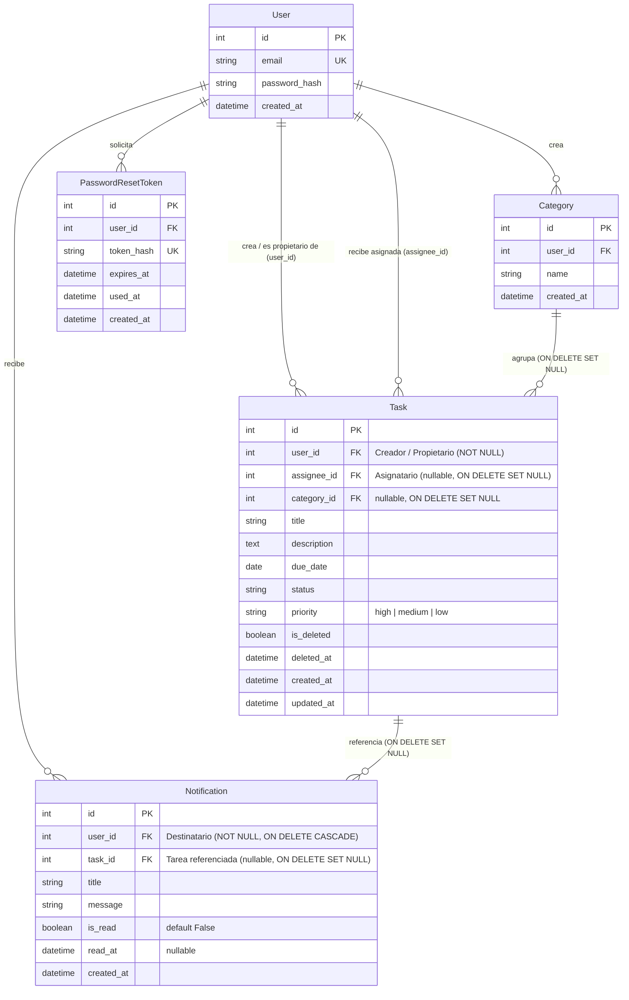

# Data Model: Colaboración entre Usuarios y Notificaciones Internas

**Feature**: `004-user-collaboration`  
**Date**: 2026-10-08  
**Principios Constitucionales**: II (Separación de capas), VI (Integridad y migraciones) y VIII (Observabilidad)  

---

## 1. Diagrama Entidad-Relación Consolidado



---

## 2. Definición Detallada de Entidades

### 2.1 Entidad `Task` (Extensión del Modelo)

Se extiende incorporando la columna `assignee_id` como clave foránea nullable hacia `users.id`:

```text
Table: tasks (Ampliación Incremento 4)
─────────────────────────────────────────────────────────────────────────────
Columna        Tipo                     Nullable    Default / Notas
─────────────────────────────────────────────────────────────────────────────
id             Integer                  No          Primary Key, Autoincrement
user_id        Integer                  No          FK -> users(id) ON DELETE CASCADE [Creador]
assignee_id    Integer                  Yes         FK -> users(id) ON DELETE SET NULL [NUEVO: Asignatario]
category_id    Integer                  Yes         FK -> categories(id) ON DELETE SET NULL
title          String(200)              No          1 a 200 caracteres sanitizados
description    Text                     Yes         Texto plano sanitizado
due_date       Date                     Yes         Fecha límite (YYYY-MM-DD)
status         String(20)               No          'pending' | 'in_progress' | 'completed'
priority       String(20)               No          'high' | 'medium' | 'low' (default 'medium')
is_deleted     Boolean                  No          Default: False (server_default: '0')
deleted_at     DateTime(timezone=True)  Yes         Default: None
created_at     DateTime(timezone=True)  No          Default: utcnow
updated_at     DateTime(timezone=True)  No          Default: utcnow, onupdate: utcnow
─────────────────────────────────────────────────────────────────────────────
Índices y Restricciones:
- ix_tasks_user_id (user_id)
- ix_tasks_assignee_id (assignee_id) [NUEVO]
- ix_tasks_assignee_id_is_deleted (assignee_id, is_deleted) [NUEVO]
- ix_tasks_user_id_is_deleted (user_id, is_deleted)
- ix_tasks_user_id_priority (user_id, priority)
- ix_tasks_category_id (category_id)
```

**Reglas de Dominio de Asignación**:
- `user_id` representa al autor/creador inmutable de la tarea. En virtud de la **matriz de permisos (`FR-018`)**, solo el creador tiene facultades para editar el contenido básico (título, descripción, fecha límite), cambiar la prioridad, asignar categoría, reasignar o desasignar la tarea, y eliminarla lógicamente.
- `assignee_id` es el usuario asignado actualmente. Puede ser igual a `user_id` (auto-asignación), un usuario registrado distinto, o `NULL` (desasignada). El asignatario tiene permisos exclusivamente para visualizar la tarea y cambiar su estado (`pending`, `in_progress`, `completed`).
- Si la cuenta del usuario asignado es eliminada en el sistema, `assignee_id` pasa automáticamente a `NULL` mediante `ON DELETE SET NULL`, preservando la tarea y su creador original intactos.

---

### 2.2 Entidad `Notification` (Nueva Entidad)

Representa una alerta interna generada en la aplicación para un usuario destinatario:

```text
Table: notifications
─────────────────────────────────────────────────────────────────────────────
Columna        Tipo                     Nullable    Default / Notas
─────────────────────────────────────────────────────────────────────────────
id             Integer                  No          Primary Key, Autoincrement
user_id        Integer                  No          FK -> users(id) ON DELETE CASCADE [Destinatario]
task_id        Integer                  Yes         FK -> tasks(id) ON DELETE SET NULL [NUEVO: Tarea referenciada]
title          String(150)              No          Título de la notificación ("Nueva tarea asignada" / "Asignación retirada")
message        String(500)              No          Mensaje explicativo con actor y tarea
is_read        Boolean                  No          Default: False, server_default: '0'
read_at        DateTime(timezone=True)  Yes         Default: None
created_at     DateTime(timezone=True)  No          Default: utcnow
─────────────────────────────────────────────────────────────────────────────
Índices:
- ix_notifications_user_id (user_id)
- ix_notifications_task_id (task_id)
- ix_notifications_user_id_is_read (user_id, is_read) [Optimización del navbar]
```

**Reglas de Dominio de Notificaciones**:
- Una notificación pertenece exclusivamente al usuario receptor (`user_id`).
- Al marcarse como leída: `is_read = True`, `read_at = utcnow()`. El registro **persiste** en el historial.
- **Preservación ante borrado de tareas**: Si la tarea asociada es eliminada lógicamente (o físicamente de la base de datos), las notificaciones asociadas NO se destruyen: persisten en el historial del usuario receptor. Si se borra físicamente la tarea, `task_id` pasa a `NULL` (`ON DELETE SET NULL`). Si la cuenta del usuario receptor es eliminada, sus notificaciones se eliminan en cascada (`ON DELETE CASCADE`). Al acceder a una notificación cuya tarea fue eliminada, el sistema expone que el recurso ya no está disponible.

---

### 2.3 Registro de Auditoría (`AuditLog`) (Nuevos Eventos)

Se amplía el catálogo de eventos auditados:
- `TASK_ASSIGNED`: Registra la asignación o reasignación de una tarea.
  - `actor_id`: Usuario que ejecutó la acción.
  - `entity_id`: `task_id`.
  - `details`: `{"previous_assignee_id": 1, "new_assignee_id": 2, "assignee_email": "colaborador@empresa.com"}`.
- `TASK_UNASSIGNED`: Registra la desasignación de una tarea dejándola sin responsable (`assignee_id = null`).
