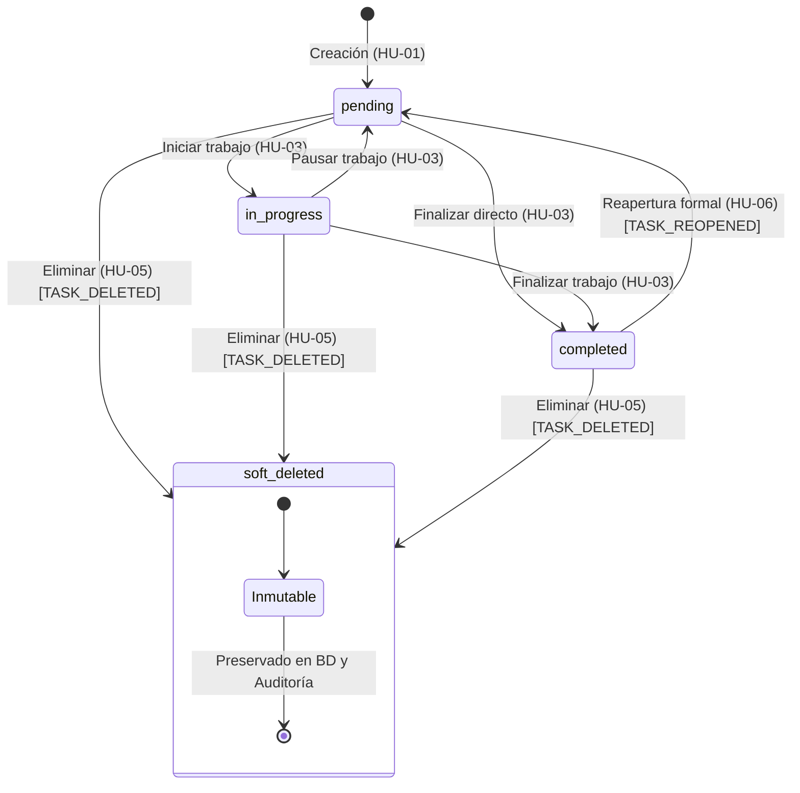

# Data Model: Cierre de Gestión Básica de Tareas y Recuperación de Acceso

**Feature**: `002-task-lifecycle-recovery`  
**Date**: 2026-10-07  
**Principio Constitucional**: VI (Integridad de datos y migraciones versionadas) y VIII (Observabilidad)  

---

## 1. Entidades del Dominio y Persistencia

### 1.1 Entidad `User` (Extensión del Modelo Existente)
Modela a los usuarios registrados. En este incremento se incorpora control de versión de sesión para permitir la revocación global inmediata de sesiones tras actualizar la contraseña (Principio VII).

```text
Table: users (Campos Relevantes)
─────────────────────────────────────────────────────────────────────────────
Column          Type                     Nullable    Default / Notes
─────────────────────────────────────────────────────────────────────────────
id              Integer                  No          Primary Key, Autoincrement
email           String(255)              No          Unique, Index, Lowercase
password_hash   String(255)              No          Hash scrypt
session_version Integer                  No          Default: 1 (server_default: '1') [NUEVO]
created_at      DateTime(timezone=True)  No          Default: utcnow
─────────────────────────────────────────────────────────────────────────────
```

**Reglas de Dominio**:
- `session_version`: Se inicializa en 1. En cada login se registra en la cookie de sesión (`session['session_version']`).
- Al completarse exitosamente un restablecimiento de contraseña (`PASSWORD_RESET_COMPLETED`), el valor de `session_version` se incrementa en 1 en la base de datos, invalidando automáticamente todas las sesiones previas activas en cualquier navegador/dispositivo.

---

### 1.2 Entidad `Task` (Extensión del Modelo Existente)
Modela una tarea individual asignada a un usuario. En este incremento se extienden sus atributos para soportar la eliminación lógica (soft delete).

```text
Table: tasks
─────────────────────────────────────────────────────────────────────────────
Column         Type                     Nullable    Default / Notes
─────────────────────────────────────────────────────────────────────────────
id             Integer                  No          Primary Key, Autoincrement
user_id        Integer                  No          Foreign Key -> users(id) ON DELETE CASCADE
title          String(200)              No          1 a 200 caracteres, texto plano sanitizado
description    Text                     Yes         Texto plano (hasta 2000 caracteres)
due_date       Date                     Yes         Fecha de calendario (YYYY-MM-DD)
status         String(20)               No          'pending' | 'in_progress' | 'completed'
is_deleted     Boolean                  No          Default: False (server_default: '0') [NUEVO]
deleted_at     DateTime(timezone=True)  Yes         Default: None [NUEVO]
created_at     DateTime(timezone=True)  No          Default: utcnow
updated_at     DateTime(timezone=True)  No          Default: utcnow, onupdate: utcnow
─────────────────────────────────────────────────────────────────────────────
Indexes:
- ix_tasks_user_id (user_id)
- ix_tasks_user_id_is_deleted (user_id, is_deleted) [NUEVO]
- ix_tasks_user_id_status (user_id, status)
```

**Reglas de Validación y Dominio**:
- `is_deleted = False`: Tarea activa. Visible en listados estándar y sujeta a transiciones ordinarias o edición.
- `is_deleted = True`: Tarea eliminada lógicamente. Oculta de listados por defecto. Inmutable (bloqueada ante edición, cambios de estado o re-eliminación). La eliminación es definitiva e irreversible para el usuario final (sin papelera ni restauración).
- `deleted_at`: Registra la fecha/hora exacta en UTC en que se ejecutó la acción de soft delete.

---

### 1.3 Entidad `PasswordResetToken` (Nueva Entidad)
Almacena las autorizaciones temporales de restablecimiento de contraseña emitidas para usuarios que lo solicitaron mediante su correo registrado.

```text
Table: password_reset_tokens
─────────────────────────────────────────────────────────────────────────────
Column         Type                     Nullable    Default / Notes
─────────────────────────────────────────────────────────────────────────────
id             Integer                  No          Primary Key, Autoincrement
user_id        Integer                  No          Foreign Key -> users(id) ON DELETE CASCADE
token_hash     String(64)               No          Hash SHA-256 del token aleatorio entregado
expires_at     DateTime(timezone=True)  No          Timestamp UTC límite (creación + 15 min)
used_at        DateTime(timezone=True)  Yes         Default: None. Registra el instante de uso
created_at     DateTime(timezone=True)  No          Default: utcnow
─────────────────────────────────────────────────────────────────────────────
Indexes:
- ix_password_reset_tokens_token_hash (token_hash) [UNIQUE]
- ix_password_reset_tokens_user_id (user_id)
```

**Reglas de Validación y Dominio**:
- **Cero secretos en persistencia**: El valor en texto plano (`raw_token`, 32 bytes en formato urlsafe) nunca se guarda en la base de datos. Solo se persiste `SHA-256(raw_token)`.
- **Validez del Token**: Un token es válido para consumo si y solo si:
  1. `token_hash == SHA-256(input_token)`
  2. `used_at IS NULL` (no ha sido utilizado previamente)
  3. `expires_at > datetime.now(timezone.utc)` (no ha expirado)
- **Consumo (Single-use)**: Tras actualizar la contraseña del usuario, se establece inmediatamente `used_at = datetime.now(timezone.utc)`.
- **Invalidación previa**: Cuando se solicita un nuevo token para un usuario, cualquier token no utilizado anterior para ese `user_id` se invalida inmediatamente marcándolo como expirado (`expires_at = datetime.now(timezone.utc)`), de forma que únicamente el último enlace emitido sea utilizable.
- **Silent Throttling (Límite de Tasa)**: Se permite un máximo de 3 solicitudes de recuperación por correo en una ventana móvil de 15 minutos. Si se excede este umbral, el backend no inserta nuevos registros de token en la tabla y retorna la misma respuesta neutra de confirmación para evitar saturación de correo y abusos (Principio VII).

---

### 1.4 Entidad `AuditLog` (Ampliación del Catálogo de Acciones)
La tabla `audit_logs` definida en el Incremento 1 se reutiliza sin alterar su estructura relacional, registrando las nuevas acciones del dominio:

```text
Table: audit_logs (Estructura Existente)
─────────────────────────────────────────────────────────────────────────────
id             Integer                  No          Primary Key
timestamp      DateTime(timezone=True)  No          Marca temporal UTC
actor_id       Integer                  Yes         ID del usuario (o None si es anónimo/sistema)
action         String(50)               No          Identificador de la acción
entity_type    String(50)               No          'Task' | 'User'
entity_id      Integer                  Yes         ID del recurso afectado
details        JSON / Text              Yes         Metadatos del evento
─────────────────────────────────────────────────────────────────────────────
```

**Nuevas Acciones Registradas en el Incremento 2**:
1. `TASK_DELETED`:
   - `entity_type`: `'Task'`
   - `entity_id`: ID de la tarea eliminada
   - `actor_id`: ID del usuario propietario autenticado
   - `details`: `{"is_deleted": true, "deleted_at": "ISO_TIMESTAMP"}`
2. `TASK_REOPENED`:
   - `entity_type`: `'Task'`
   - `entity_id`: ID de la tarea reabierta
   - `actor_id`: ID del usuario propietario autenticado
   - `details`: `{"previous_status": "completed", "new_status": "pending"}`
3. `PASSWORD_RESET_COMPLETED`:
   - `entity_type`: `'User'`
   - `entity_id`: ID del usuario cuya contraseña fue restablecida
   - `actor_id`: ID del usuario
   - `details`: `{"method": "token_recovery"}` *(sin contraseñas ni tokens en el log)*

---

## 2. Máquina de Estados del Ciclo de Vida de Tareas



### Tabla de Transiciones Permitidas y Prohibidas

| Estado Origen | Estado Destino | Acción / Método | Permitida? | Evento de Auditoría Emitido |
|---|---|---|:---:|---|
| `pending` | `in_progress` | `change_task_status` | **SÍ** | `TASK_STATUS_CHANGED` |
| `pending` | `completed` | `change_task_status` | **SÍ** | `TASK_STATUS_CHANGED` |
| `in_progress` | `pending` | `change_task_status` | **SÍ** | `TASK_STATUS_CHANGED` |
| `in_progress` | `completed` | `change_task_status` | **SÍ** | `TASK_STATUS_CHANGED` |
| `completed` | `pending` | `change_task_status` ordinario | **NO (400)** | *Ninguno (rechazado; exige acción de reapertura)* |
| `completed` | `pending` | `reopen_task` | **SÍ** | `TASK_REOPENED` |
| `completed` | `in_progress` | Cualquier acción | **NO (400)** | *Ninguno (debe reabrirse a pending primero)* |
| Cualquier estado activo | Eliminada (`is_deleted=True`) | `delete_task` | **SÍ** | `TASK_DELETED` |
| Eliminada | Cualquier estado | Cualquier acción | **NO (400)** | *Ninguno (bloqueado; no se puede alterar tarea eliminada)* |
| Eliminada | Eliminada | `delete_task` | **NO (400)** | *Ninguno (rechazo: tarea ya eliminada)* |
