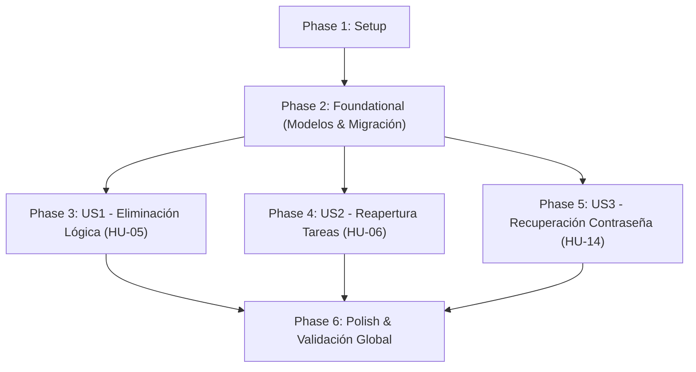

# Tasks: Cierre de Gestión Básica de Tareas y Recuperación de Acceso

**Branch**: `002-task-lifecycle-recovery` | **Date**: 2026-10-11 | **Spec**: [spec.md](specs/002-task-lifecycle-recovery/spec.md) | **Plan**: [plan.md](specs/002-task-lifecycle-recovery/plan.md)

---

## Phase 1: Setup (Infraestructura Compartida y Entorno)

**Purpose**: Preparación de herramientas de testing y componentes base desacoplados sin dependencias externas.

- [ ] T001 Actualizar dependencias en requirements.txt agregando `pytest-cov==5.0.0` para medición de cobertura automatizada
- [ ] T002 [P] Configurar fixtures compartidas en tests/conftest.py con SQLite en memoria (`sqlite:///:memory:`), cliente de pruebas Flask y soporte de tokens CSRF
- [ ] T003 [P] Implementar abstracción `EmailSender` y clase `ConsoleEmailSender` en src/taskcontrol/services/email_service.py para emitir enlaces de recuperación mediante el logger estructurado `taskcontrol.email`

---

## Phase 2: Foundational (Esquema de Base de Datos y Migración Incremental)

**Purpose**: Modificaciones estructurales y de modelo que bloquean la implementación de las historias de usuario.

> ⚠️ **CRÍTICO**: Ninguna historia de usuario puede implementarse hasta completar esta fase.

- [ ] T004 Extender modelo User en src/taskcontrol/models/user.py agregando columna `session_version = db.Column(db.Integer, default=1, server_default='1', nullable=False)` para control de revocación global de sesiones
- [ ] T005 [P] Extender modelo Task en src/taskcontrol/models/task.py agregando columnas `is_deleted = db.Column(db.Boolean, default=False, server_default='0', nullable=False)`, `deleted_at = db.Column(db.DateTime(timezone=True), nullable=True)` e índice compuesto `ix_tasks_user_id_is_deleted` sobre `(user_id, is_deleted)`
- [ ] T006 [P] Crear modelo PasswordResetToken en src/taskcontrol/models/password_reset_token.py con `id` (Integer PK), `user_id` (Integer FK `users.id` con `ondelete='CASCADE'`), `token_hash` (`String(64)` not null, unique, index), `expires_at` (`DateTime(timezone=True)` not null), `used_at` (`DateTime(timezone=True)` nullable) y `created_at` (`DateTime(timezone=True)` not null)
- [ ] T007 Registrar PasswordResetToken en src/taskcontrol/models/__init__.py exportándolo en `__all__`
- [ ] T008 [P] Definir excepciones de dominio `TaskAlreadyDeletedError(ServiceError)` e `InvalidTokenError(ServiceError)` con códigos y estados HTTP en src/taskcontrol/services/errors.py
- [ ] T009 Generar y verificar script de migración versionado en migrations/versions/b1e2c3d4e5f6_add_soft_delete_and_password_reset.py con `server_default='0'` para tareas y `server_default='1'` para usuarios, garantizando cero pérdida o alteración de datos existentes del Incremento 1 (Principio VI)

**Checkpoint**: Base de datos, modelos y excepciones listos. La implementación de historias de usuario puede comenzar.

---

## Phase 3: User Story 1 - Eliminación Lógica de Tareas (HU-05) (Priority: P1) ⭐ MVP

**Goal**: Permitir al usuario autenticado eliminar lógicamente tareas de su propiedad de forma definitiva e irreversible, excluyéndolas de los listados estándar sin eliminarlas físicamente de la base de datos y preservando la trazabilidad en el log de auditoría (`TASK_DELETED`).

**Independent Test**: Crear una tarea activa, solicitar su eliminación lógica vía POST; verificar que desaparece de `/tasks`, que en la base de datos permanece con `is_deleted=True` y `deleted_at`, que el log de auditoría registra `TASK_DELETED`, y que re-eliminar o editar la tarea eliminada es bloqueado por el backend.

### Tests for User Story 1 (TDD - Escribir primero y verificar que fallen en rojo 🔴)

> **NOTA**: Ejecutar `pytest tests/unit/test_task_service.py` y `pytest tests/integration/test_task_lifecycle_routes.py` para constatar el fallo inicial antes de implementar.

- [ ] T010 [P] [US1] Escribir pruebas unitarias en rojo en tests/unit/test_task_service.py para eliminación lógica: verificar `test_soft_delete_task_success`, `test_soft_deleted_task_excluded_from_listing`, `test_cannot_delete_already_deleted_task`, `test_cannot_edit_or_change_status_of_deleted_task` y `test_soft_delete_is_permanent_for_user`
- [ ] T011 [P] [US1] Escribir pruebas de integración HTTP en rojo en tests/integration/test_task_lifecycle_routes.py para `POST /tasks/<id>/delete`: verificar autenticación obligatoria, validación de token CSRF, redirección 302 con flash a `/tasks`, aislamiento por usuario (404/403 ante tareas ajenas) y rechazo 400 ante re-eliminación

### Implementation for User Story 1

- [ ] T012 [US1] Modificar consultas de lectura `get_user_tasks` y `get_user_task` en src/taskcontrol/services/task_service.py agregando incondicionalmente el filtro `Task.is_deleted == False`
- [ ] T013 [US1] Actualizar métodos `update_task` y `change_task_status` en src/taskcontrol/services/task_service.py para verificar que la tarea no esté eliminada, lanzando `TaskAlreadyDeletedError` si `task.is_deleted == True`
- [ ] T014 [US1] Implementar método `delete_task(user_id, task_id)` en src/taskcontrol/services/task_service.py: verificar pertenencia, validar que no esté previamente eliminada, fijar `is_deleted=True`, `deleted_at=utcnow()` y emitir evento inmutable `TASK_DELETED` mediante AuditService
- [ ] T015 [US1] Implementar controlador `POST /tasks/<int:task_id>/delete` con decorador `@login_required` y protección CSRF en src/taskcontrol/blueprints/tasks.py delegando en `TaskService.delete_task` y redirigiendo a `/tasks` con flash
- [ ] T016 [US1] Actualizar vista de listado en src/taskcontrol/templates/tasks/index.html agregando en cada tarea activa un formulario POST hacia `/tasks/<id>/delete` con campo oculto `csrf_token()`, botón "Eliminar" y confirmación interactiva de usuario

**Checkpoint**: User Story 1 completa y verificada con 100% de pruebas en verde. El borrado lógico opera de forma independiente y segura.

---

## Phase 4: User Story 2 - Reapertura Controlada de Tareas Completadas (HU-06) (Priority: P1)

**Goal**: Permitir al usuario autenticado reactivar una tarea completada devolviéndola unívoca y deterministamente al estado activo "pendiente" (`pending`), registrando en la auditoría el evento específico `TASK_REOPENED` diferenciado de cambios ordinarios y creaciones.

**Independent Test**: Tomar una tarea propia en estado `completed`, invocar `POST /tasks/<id>/reopen`; verificar que transiciona a `pending`, que se visualiza nuevamente en el listado activo, que en `audit_logs` se inserta `TASK_REOPENED` con metadatos `{"previous_status": "completed", "new_status": "pending"}`, y que reabrir tareas en `pending`, `in_progress` o eliminadas es rechazado con error 400.

### Tests for User Story 2 (TDD - Escribir primero y verificar que fallen en rojo 🔴)

> **NOTA**: Ejecutar pruebas y confirmar fallo inicial antes de codificar la reapertura.

- [ ] T017 [P] [US2] Escribir pruebas unitarias en rojo en tests/unit/test_task_service.py para reapertura: verificar `test_reopen_completed_task_success` (transición a `pending` y log `TASK_REOPENED`), `test_cannot_reopen_pending_or_in_progress_task` (rechazo 400) y `test_cannot_reopen_deleted_task` (rechazo 400)
- [ ] T018 [P] [US2] Escribir pruebas de integración HTTP en rojo en tests/integration/test_task_lifecycle_routes.py para `POST /tasks/<id>/reopen`: verificar autenticación `@login_required`, token CSRF requerido, aislamiento por usuario y redirección 302 con flash a `/tasks`

### Implementation for User Story 2

- [ ] T019 [US2] Implementar método `reopen_task(user_id, task_id)` en src/taskcontrol/services/task_service.py: validar existencia y titularidad, validar `task.is_deleted == False`, validar `task.status == 'completed'`, fijar `task.status = TaskStatus.PENDING` y registrar auditoría `TASK_REOPENED` con detalles `{"previous_status": "completed", "new_status": "pending"}`
- [ ] T020 [US2] Implementar controlador `POST /tasks/<int:task_id>/reopen` con decorador `@login_required` y protección CSRF en src/taskcontrol/blueprints/tasks.py delegando en `TaskService.reopen_task` y redirigiendo a `/tasks` con flash
- [ ] T021 [US2] Actualizar vista src/taskcontrol/templates/tasks/index.html mostrando el formulario POST de "Reabrir Tarea" con token CSRF exclusivamente en filas de tareas con estado `completed`, manteniendo oculto el formulario para tareas activas

**Checkpoint**: User Stories 1 y 2 completamente operativas e integradas de forma independiente.

---

## Phase 5: User Story 3 - Recuperación Segura de Contraseña y Acceso (HU-14) (Priority: P2)

**Goal**: Permitir al usuario que olvidó su clave solicitar el restablecimiento mediante correo con respuesta neutra ciega (blind response), tokens efímeros de 15 minutos con hash SHA-256 e invalidación de enlaces previos, estrangulamiento silencioso (silent throttling máx. 3 por 15 min), y revocación global de sesiones activas al actualizar la contraseña.

**Independent Test**: Solicitar recuperación para correo registrado y no registrado verificando respuestas neutras idénticas; comprobar silent throttling a partir del 4to intento; validar token y actualizar clave con hash `scrypt`; verificar que la contraseña anterior deja de funcionar, que las sesiones activas en otros navegadores son rechazadas por cambio de `session_version`, y que el token consumido es bloqueado en usos posteriores.

### Tests for User Story 3 (TDD - Escribir primero y verificar que fallen en rojo 🔴)

> **NOTA**: Ejecutar pruebas unitarias e integración de recuperación confirmando que fallen en rojo antes de implementar `RecoveryService`.

- [ ] T022 [P] [US3] Escribir pruebas unitarias en rojo en tests/unit/test_recovery_service.py: verificar `test_request_reset_unregistered_email_silent`, `test_request_reset_registered_email_creates_token` (15 min y hash SHA-256), `test_request_reset_invalidates_prior_unused_tokens`, `test_request_reset_silent_throttling_limit` (4to intento en 15 min no emite token), `test_reset_password_with_valid_token`, `test_reset_password_revokes_all_active_sessions` (incremento de `session_version`), `test_reset_password_with_expired_token_fails` y `test_reset_password_with_used_token_fails`
- [ ] T023 [P] [US3] Escribir pruebas de integración HTTP en rojo en tests/integration/test_recovery_routes.py para flujos de recuperación: verificar `GET/POST /forgot-password` (con CSRF y respuesta ciega 302/200), `GET /reset-password/<token>` (renderizado de formulario o 302 ante token inválido/expirado) y `POST /reset-password/<token>` (CSRF, validación de contraseñas coincidentes $\ge 8$ caracteres, y redirección a login)

### Implementation for User Story 3

- [ ] T024 [US3] Implementar RecoveryService en src/taskcontrol/services/recovery_service.py: método `request_password_reset(email)` con normalización, silent throttling (máx. 3 solicitudes por correo cada 15 min), invalidación de tokens previos no consumidos, generación con `secrets.token_urlsafe(32)`, persistencia de hash SHA-256 con expiración en 15 min y despacho vía `ConsoleEmailSender`; método `verify_reset_token(raw_token)` validando no expirado ni usado; y método `reset_password(raw_token, new_password)` validando complejidad, actualizando `password_hash` (`scrypt`), incrementando `user.session_version += 1`, marcando `used_at=utcnow()` y registrando auditoría `PASSWORD_RESET_COMPLETED`
- [ ] T025 [US3] Actualizar decorador `@login_required` en src/taskcontrol/blueprints/decorators.py validando que `session.get('session_version') == user.session_version`, limpiando la sesión (`session.clear()`) y exigiendo reautenticación si hay discrepancia de versión (Principio VII)
- [ ] T026 [US3] Actualizar controlador `login` en src/taskcontrol/blueprints/auth.py registrando en la cookie de sesión `session['session_version'] = user.session_version` tras la autenticación exitosa
- [ ] T027 [US3] Implementar rutas `GET /forgot-password` y `POST /forgot-password` con validación de token CSRF en src/taskcontrol/blueprints/auth.py delegando en `RecoveryService.request_password_reset` y emitiendo respuesta ciega neutra
- [ ] T028 [US3] Implementar rutas `GET /reset-password/<token>` y `POST /reset-password/<token>` con validación CSRF en src/taskcontrol/blueprints/auth.py delegando en `RecoveryService.verify_reset_token` y `RecoveryService.reset_password`
- [ ] T029 [US3] Crear plantillas HTML en src/taskcontrol/templates/auth/forgot_password.html y src/taskcontrol/templates/auth/reset_password.html con campo oculto `csrf_token()`, maquetación semántica y renderizado de errores de validación
- [ ] T030 [US3] Actualizar plantilla src/taskcontrol/templates/auth/login.html añadiendo enlace accesible "¿Olvidaste tu contraseña?" apuntando a `auth.forgot_password`

**Checkpoint**: Recuperación de contraseña completamente funcional, con silent throttling, tokens seguros y revocación global de sesión.

---

## Phase 6: Polish & Cross-Cutting Concerns

**Purpose**: Verificación integral de calidad, cobertura, estilos y escenarios de extremo a extremo.

- [ ] T031 [P] Actualizar estilos en src/taskcontrol/static/css/styles.css para botones de acción "Eliminar" (peligro/rojo), "Reabrir" (secundario/azul) y formularios de recuperación de contraseña
- [ ] T032 Ejecutar la suite completa de pruebas unitarias y de integración con reporte de cobertura (`pytest --cov=src/taskcontrol tests/`) confirmando 100% de tests en verde y cero regresiones sobre HU-01 a HU-04 y HU-12/13
- [ ] T033 Ejecutar y validar manualmente los 5 escenarios descritos en specs/002-task-lifecycle-recovery/quickstart.md (soft delete, reapertura, respuesta ciega en consola, restablecimiento de contraseña e invalidación de sesión, y silent throttling)

---

## Dependencies & Execution Order

### Phase Dependencies



### User Story Dependencies

- **User Story 1 (P1 - HU-05)**: Depende exclusivamente de Phase 2 (Foundational: columnas `is_deleted`, `deleted_at`). Puede desarrollarse y probarse de forma autónoma.
- **User Story 2 (P1 - HU-06)**: Depende de Phase 2 y se integra sobre `TaskService`. No depende del flujo de User Story 3 ni bloquea a User Story 1.
- **User Story 3 (P2 - HU-14)**: Depende de Phase 2 (tabla `password_reset_tokens` y columna `session_version`). Es completamente independiente de la gestión de tareas.

### Within Each User Story

1. Escribir pruebas unitarias e integración obligatorias.
2. Ejecutar suite de pruebas y confirmar estado en rojo (FAIL / RED).
3. Implementar modificaciones en capa de modelos y servicios.
4. Implementar endpoints en blueprints con protección CSRF.
5. Implementar o actualizar vistas en plantillas Jinja2.
6. Re-ejecutar pruebas y confirmar estado en verde (PASS / GREEN).

---

## Parallel Opportunities

- **Fase 1 (Setup)**: T002 (`conftest.py`) y T003 (`email_service.py`) son independientes y paralelizables.
- **Fase 2 (Foundational)**: T005 (`Task`) y T006 (`PasswordResetToken`) pueden desarrollarse en paralelo antes de la migración (T009).
- **Fase 3 (US1)**: Las pruebas T010 y T011 pueden escribirse en paralelo.
- **Fase 4 (US2)**: Las pruebas T017 y T018 pueden escribirse en paralelo.
- **Fase 5 (US3)**: Las pruebas T022 y T023 pueden escribirse en paralelo.
- **Entre Historias**: Una vez completada Phase 2, User Story 1, User Story 2 y User Story 3 pueden ejecutarse en paralelo por desarrolladores independientes.

---

## Parallel Example: User Story 1 (HU-05)

```bash
# Escribir y verificar en paralelo las pruebas en rojo:
pytest tests/unit/test_task_service.py -k "test_soft_delete"
pytest tests/integration/test_task_lifecycle_routes.py -k "delete"

# Modificar en paralelo el servicio y la plantilla:
Task T012 / T014: "src/taskcontrol/services/task_service.py"
Task T016: "src/taskcontrol/templates/tasks/index.html"
```

---

## Implementation Strategy

### MVP First (User Story 1 - HU-05)

1. Completar **Phase 1: Setup** (fixtures de testing y `ConsoleEmailSender`).
2. Completar **Phase 2: Foundational** (extensión de esquemas y migración con `server_default='0'`).
3. Implementar **Phase 3: User Story 1** (pruebas en rojo, soft delete en servicio, endpoint POST `/tasks/<id>/delete` y botón en UI).
4. **VALIDAR MVP**: Verificar que las tareas se eliminan lógicamente sin pérdida de datos en BD y que `TASK_DELETED` se audita.

### Entrega Incremental

1. Finalizado el MVP de eliminación lógica (US1), proceder con **Phase 4: User Story 2 (HU-06)** habilitando la reapertura determinista a `pending`.
2. Proceder con **Phase 5: User Story 3 (HU-14)** implementando la recuperación de cuentas con blind response, silent throttling y revocación global de sesiones.
3. Concluir con **Phase 6: Polish** asegurando cero regresiones sobre HU-01 a HU-04 y HU-12/13.
