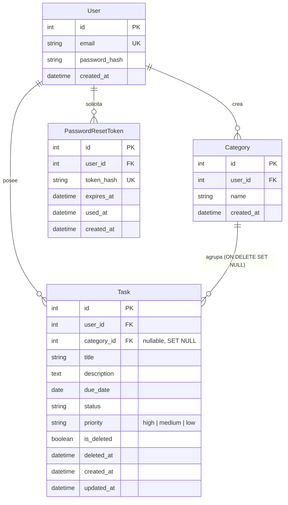

# Data Model: Organización y Priorización de Tareas

**Feature**: `003-task-organization-priority`  
**Date**: 2026-10-07  
**Principio Constitucional**: II (Separación de capas), VI (Integridad y migraciones) y VIII (Observabilidad)  

---

## 1. Diagrama Entidad-Relación



---

## 2. Definición Detallada de Entidades

### 2.1 Entidad `Category` (Nueva Entidad)
Representa un agrupador temático o proyecto personal del usuario.

```text
Table: categories
─────────────────────────────────────────────────────────────────────────────
Column         Type                     Nullable    Default / Notes
─────────────────────────────────────────────────────────────────────────────
id             Integer                  No          Primary Key, Autoincrement
user_id        Integer                  No          Foreign Key -> users(id) ON DELETE CASCADE
name           String(50)               No          Nombre de la categoría (1-50 chars)
created_at     DateTime(timezone=True)  No          Default: utcnow
─────────────────────────────────────────────────────────────────────────────
Constraints & Indexes:
- uq_categories_user_id_name (user_id, name) [UNIQUE]
- ix_categories_user_id (user_id)
```

**Reglas de Dominio**:
- El nombre es obligatorio, normalizado con trim, con longitud entre 1 y 50 caracteres.
- Un usuario no puede tener dos categorías con el mismo nombre (insensible a mayúsculas/minúsculas).
- Una categoría solo es visible y utilizable por su usuario creador (`user_id`).

---

### 2.2 Entidad `Task` (Extensión del Modelo Existente)
Se amplía para incorporar los campos `priority` y `category_id`, y exponer el atributo derivado en memoria `is_overdue`.

```text
Table: tasks (Ampliación)
─────────────────────────────────────────────────────────────────────────────
Column         Type                     Nullable    Default / Notes
─────────────────────────────────────────────────────────────────────────────
id             Integer                  No          Primary Key, Autoincrement
user_id        Integer                  No          Foreign Key -> users(id) ON DELETE CASCADE
category_id    Integer                  Yes         Foreign Key -> categories(id) ON DELETE SET NULL [NUEVO]
title          String(200)              No          1 a 200 caracteres, texto plano sanitizado
description    Text                     Yes         Texto plano sanitizado
due_date       Date                     Yes         Fecha límite (YYYY-MM-DD)
status         String(20)               No          'pending' | 'in_progress' | 'completed'
priority       String(20)               No          Default: 'medium' (server_default: 'medium') [NUEVO]
is_deleted     Boolean                  No          Default: False (server_default: '0')
deleted_at     DateTime(timezone=True)  Yes         Default: None
created_at     DateTime(timezone=True)  No          Default: utcnow
updated_at     DateTime(timezone=True)  No          Default: utcnow, onupdate: utcnow
─────────────────────────────────────────────────────────────────────────────
Indexes:
- ix_tasks_user_id (user_id)
- ix_tasks_user_id_is_deleted (user_id, is_deleted)
- ix_tasks_user_id_priority (user_id, priority) [NUEVO]
- ix_tasks_category_id (category_id) [NUEVO]
```

**Reglas de Dominio de Prioridad**:
- Valores permitidos para `priority`: `'high'`, `'medium'`, `'low'`.
- Valor predeterminado si no se especifica: `'medium'`.
- Ponderación de orden descendente: `'high'` (3) $\rightarrow$ `'medium'` (2) $\rightarrow$ `'low'` (1).

**Reglas de Dominio de Categoría y Desvinculación**:
- Una tarea pertenece a máximo una categoría o a ninguna (`category_id = NULL`).
- Si la categoría asignada es eliminada, el motor relacional ejecuta `ON DELETE SET NULL`, preservando la tarea intacta con `category_id = NULL`.

**Regla de Negocio de Vencimiento (`is_overdue`)**:
- Atributo puramente derivado en el backend (no persistido en base de datos):
  ```python
  @property
  def is_overdue(self) -> bool:
      if self.is_deleted or self.status == 'completed' or self.due_date is None:
          return False
      return self.due_date < datetime.now(timezone.utc).date()
  ```

---

### 2.3 Entidad `AuditLog` (Nuevas Acciones)
Se extiende el catálogo de eventos auditados:
- `TASK_PRIORITY_CHANGED`: Registra cambio de prioridad con `previous_priority` y `new_priority`.
- `TASK_CATEGORY_ASSIGNED`: Registra asignación o desasignación de categoría (`previous_category_id`, `new_category_id`).
- `CATEGORY_CREATED`: Registra creación de categoría por un usuario.
- `CATEGORY_UPDATED`: Registra modificación de nombre de categoría.
- `CATEGORY_DELETED`: Registra eliminación de categoría.
