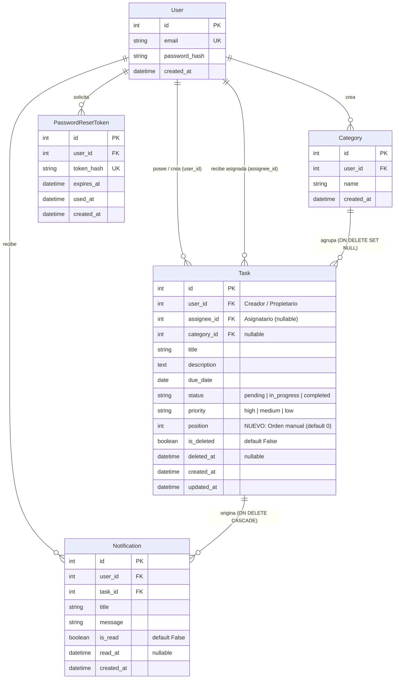

# Data Model: Mejoras Frontend JavaScript y Drag and Drop

**Feature**: `005-frontend-interaction`  
**Date**: 2026-10-08  
**Principios Constitucionales**: II (Separación de capas), VI (Integridad y migraciones) y VII (Seguridad por defecto)  

---

## 1. Diagrama Entidad-Relación Consolidado Final



---

## 2. Definición del Campo `position` en la Entidad `Task`

Se incorpora el campo de orden como único cambio relacional del incremento:

```text
Table: tasks (Ampliación Final)
─────────────────────────────────────────────────────────────────────────────
Columna        Tipo                     Nullable    Default / Notas
─────────────────────────────────────────────────────────────────────────────
id             Integer                  No          Primary Key, Autoincrement
user_id        Integer                  No          FK -> users(id) ON DELETE CASCADE
assignee_id    Integer                  Yes         FK -> users(id) ON DELETE SET NULL
category_id    Integer                  Yes         FK -> categories(id) ON DELETE SET NULL
title          String(200)              No          1 a 200 caracteres sanitizados
description    Text                     Yes         Texto plano sanitizado
due_date       Date                     Yes         Fecha límite (YYYY-MM-DD)
status         String(20)               No          'pending' | 'in_progress' | 'completed'
priority       String(20)               No          'high' | 'medium' | 'low' (default 'medium')
position       Integer                  No          NUEVO: Orden manual persistido (server_default: '0')
is_deleted     Boolean                  No          Default: False (server_default: '0')
deleted_at     DateTime(timezone=True)  Yes         Default: None
created_at     DateTime(timezone=True)  No          Default: utcnow
updated_at     DateTime(timezone=True)  No          Default: utcnow, onupdate: utcnow
─────────────────────────────────────────────────────────────────────────────
Índices:
- ix_tasks_user_id (user_id)
- ix_tasks_user_id_position (user_id, position) [NUEVO: Optimización de orden manual]
- ix_tasks_user_id_is_deleted (user_id, is_deleted)
- ix_tasks_assignee_id (assignee_id)
- ix_tasks_user_id_priority (user_id, priority)
- ix_tasks_category_id (category_id)
```

**Reglas de Dominio del Orden Persistido**:
- `position` representa la posición relativa de una tarea dentro del espacio personal de trabajo de un usuario (`user_id`).
- Valor inicial para tareas nuevas o preexistentes: `0`.
- Cuando todas las tareas tienen `position = 0` (estado inicial), el listado desempata automáticamente por fecha de creación descendente (`created_at DESC`).
- Cuando el usuario reordena mediante drag-and-drop, las tareas afectadas reciben valores enteros consecutivos ($0, 1, 2, \dots$) asignados en `TaskService.reorder_tasks`.
